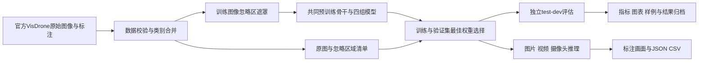
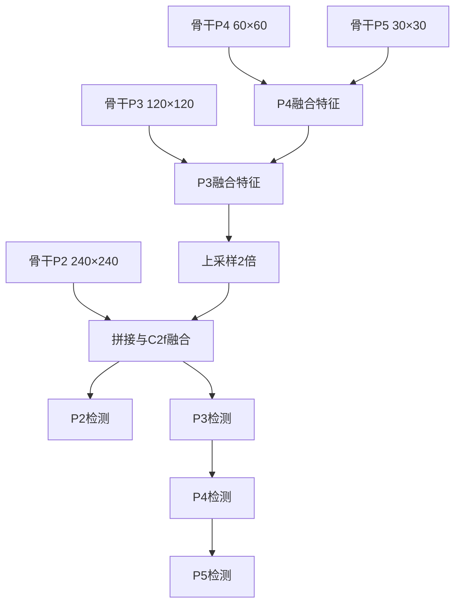
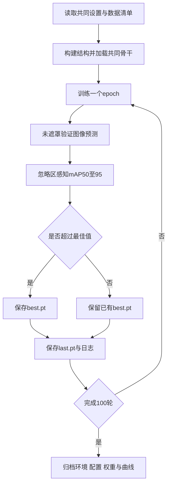
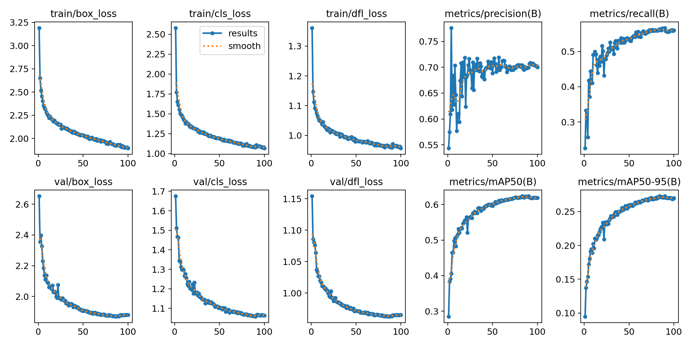
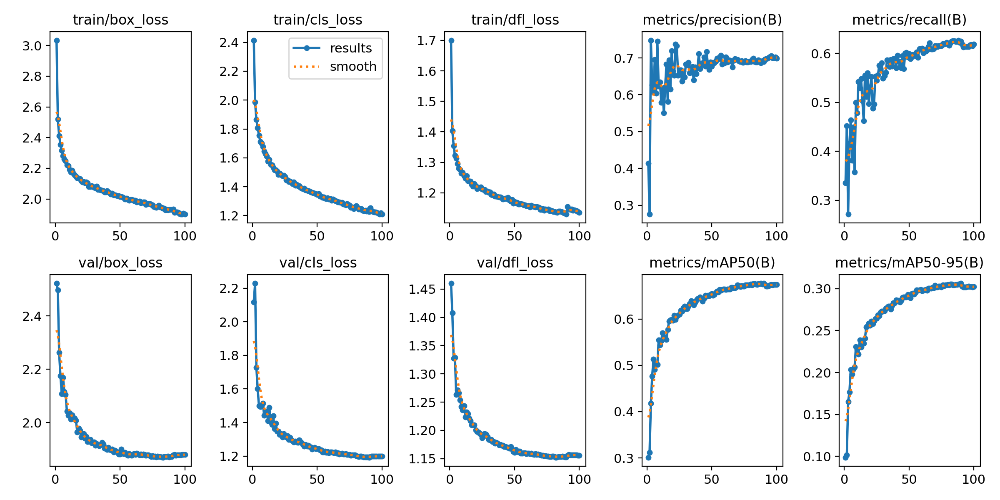
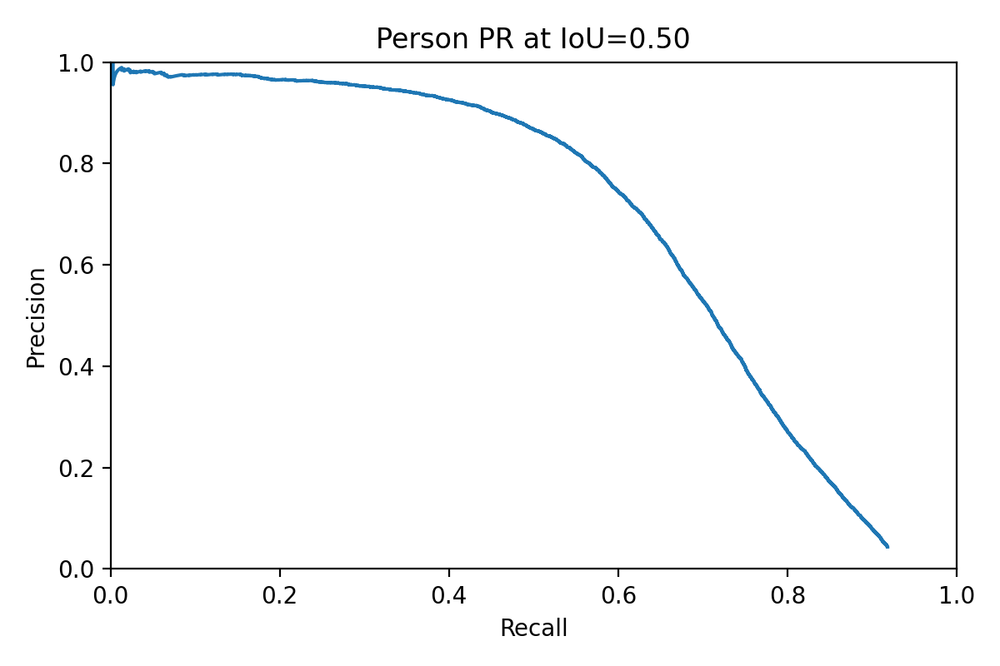
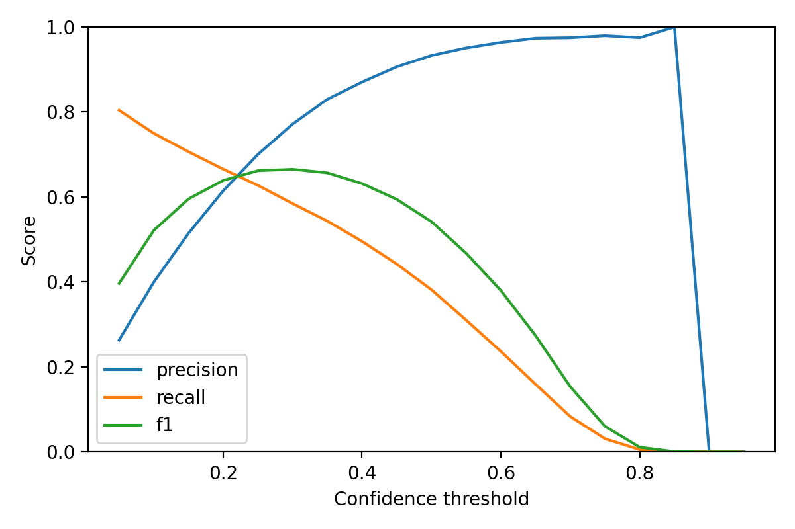
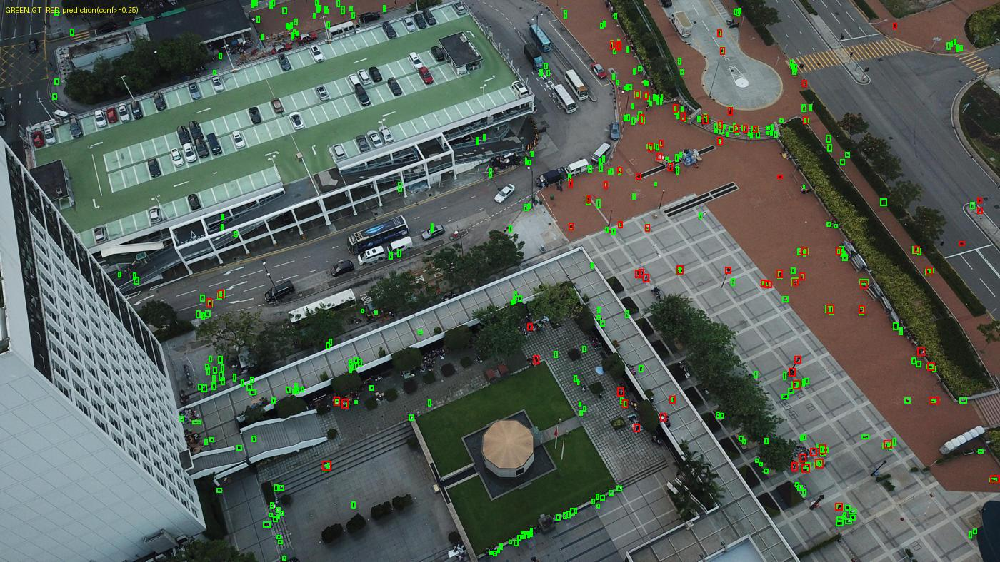
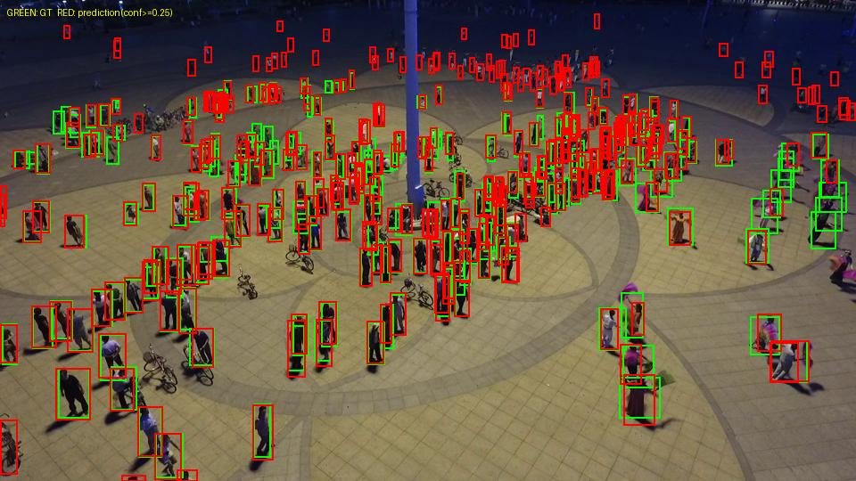
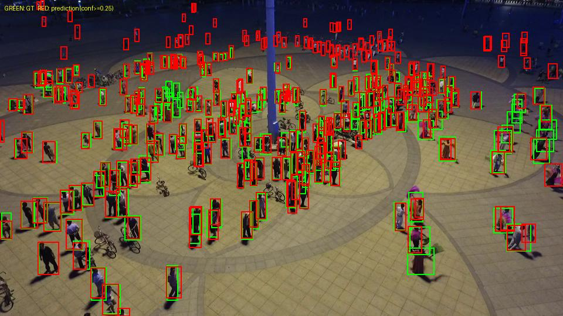

# 基于YOLOv8的远景行人检测

## 封面信息

中南大学《智能系统工程训练》报告

题目：基于YOLOv8的远景行人检测  
学生姓名：________  
学号：________  
专业班级：________  
小组成员与实际分工：________  
完成时间：________

## 内容提要

远景图像中的人体目标通常占据较少像素，轮廓和局部纹理在网络下采样过程中容易损失，密集分布和遮挡还会增加定位与分类难度。本项目面向高处或无人机视角，构建以YOLOv8n为基础的单类人体检测系统。系统在骨干P2、P3阶段加入轻量ECA通道注意力，并通过P2高分辨率检测分支融合浅层细节与深层语义，形成基线、仅ECA、仅P2及ECA与P2组合四组可独立训练的模型。

数据采用VisDrone2019-DET，保持原始训练、验证及test-dev划分，将站立或行走的pedestrian与其他姿态的people合并为person。程序在训练阶段遮罩忽略区域并保护有效人体像素，评估阶段使用原图及单独保存的忽略区域。实验采用统一骨干初始化、共同训练参数、忽略区域感知mAP及原图尺度AP_small，另分析输入分辨率、置信度和推理延迟。系统提供Windows环境配置、训练恢复、图片与视频检测、JSON/CSV输出和结果归档。

在Linux服务器上，四组模型均以960输入、batch=8完成100轮训练，并用验证集选择权重、在test-dev独立测试。test-dev上，基线与ECA+P2的mAP50–95分别为14.78%和17.28%，AP_small分别为11.08%和13.45%；主要收益来自P2分支，单独ECA收益有限。完整模型的960输入FP32模型前向平均延迟为4.39 ms，基线为3.40 ms。实验表明小目标检测能力与计算开销同时增加，结论限于本次单种子、单类人体及航拍视角。项目同时讨论隐私、误检与漏检风险、算力成本和应用范围。

关键词：YOLOv8；远景人体检测；ECA；P2检测分支；多尺度特征融合；VisDrone

## 目录

1. 项目目的与工程需求
2. 相关技术与方案论证
3. 系统组成与数据处理
4. YOLOv8基础网络与损失函数
5. ECA与P2改进模型
6. 软件实现与运行环境
7. 实验设计与评价方法
8. 本地验证与正式实验记录
9. 工程伦理与项目管理
10. 总结与个人心得
11. 参考文献
12. 源程序附录

## 1 项目目的与工程需求

### 1.1 研究背景与应用价值

人体检测需要回答图像中是否有人以及人在什么位置。与整幅图像分类不同，检测器必须同时判断目标类别和边界位置，并在多人、遮挡、背景复杂等条件下避免重复检测。传统行人检测通过人工设计的梯度或纹理特征描述人体外观，深度学习方法则从标注样本学习用于分类与定位的表示。[1,7] 这种能力可以支持交通流观察、人员搜寻和场景分析，但二维框本身不包含身份、行为意图或真实距离信息。

本课题把“远景”落实为图像上的小尺度目标。在高处或无人机拍摄条件下，视场较大，同一帧可以同时包含道路、建筑、植被和不同尺寸的人体。某些人体只有少量像素，局部纹理不足以单独形成稳定的判别信息；目标周围的上下文、不同层级特征的融合和细节保留因此成为方案设计重点。[3,4]

系统的工程价值在于建立可测量、可解释、可复现的完整流程。仅展示几张画框图片不能证明检测能力；只有在固定数据划分、固定评价口径和相同训练预算下比较精度与开销，才能判断改进的实际作用。项目因此把数据处理、模型修改、实验记录和输出接口同时纳入实现范围。

### 1.2 任务书要求与设计对应

任务书要求围绕远景行人设计快速有效的YOLOv8检测框架，理解并修改基本网络，并兼顾浅层细节与深层语义。项目将这些要求转换为可以检查的设计内容。

| 任务要求 | 实现方式 | 检查证据 |
|---|---|---|
| 以远景行人为检测对象 | VisDrone航拍图像、单类person输出 | 数据清单、目标尺度统计、检测样例 |
| 理解并修改YOLOv8框架 | 基线与ECA、P2、ECA+P2四组模型 | 网络配置、模块源码、前向与梯度测试 |
| 添加注意力机制 | 骨干两个C2f输出接ECA | 权重梯度、初始化记录、消融比较 |
| 兼顾浅层与深层特征 | P2上采样拼接与P2–P5输出 | 系统框图、特征图步长、AP_small |
| 快速有效检测 | 统一尺寸与精度测延迟和检测指标 | 500次计时、正式测试表 |
| 完整工程训练材料 | 程序、报告、答辩内容、演示安排 | 运行文档、结果包、引用核验记录 |

任务书没有规定最低mAP或FPS。因此不能用任意选取的数值充当合格线。验收关注程序是否可运行、实验是否公平、结论是否由数据支持，以及设计是否解释了精度和速度的关系。

### 1.3 功能需求与输入输出

程序输入包括图片、图片目录、视频文件或摄像头编号。训练输入还包括YOLO格式标注、数据清单、共同训练设置及官方YOLOv8n预训练权重。推理输出由原图像素坐标的边界框、person类别和置信度组成，同时保存可视化图片或视频及JSON/CSV记录。

系统需要正确处理没有人体的图像、没有预测的帧、损坏图片、越界标注和无法打开的视频。没有预测并不等于程序失败，JSON仍保存该帧和空检测列表。无法读取输入属于运行错误，应给出明确异常，不能产生一份看似成功但内容为空的结果文件。

非功能需求包括独立环境、共同参数、可恢复训练和结果追溯。不同模型之间不能使用不同测试图片，不能因为某组显存不足而只调整该组输入尺寸，也不能把测试集作为调整置信度的依据。每次运行应保留数据清单哈希、环境信息和实际训练设置。

## 2 相关技术与方案论证

### 2.1 从人工特征到深度目标检测

HOG利用局部方向梯度形成图像描述，体现了早期行人检测依赖人工特征设计的思路。[7] R-CNN将区域候选与卷积特征结合，推动了深度表示在目标检测中的应用。[8] Faster R-CNN通过区域建议网络共享卷积特征，减少候选区域生成阶段的独立计算。[9] 这些方法说明，检测性能既受特征质量影响，也受候选生成和定位方式影响。

两阶段方法先生成候选，再进行细化分类与回归；单阶段方法直接在特征图上预测目标。两者不能简单按名称判断优劣，应考虑数据、模型规模、推理设置和部署资源。针对本课程的结构改动与速度分析需求，单阶段YOLO框架便于建立完整训练及推理流程。[2]

### 2.2 YOLO系列与YOLOv8选择

YOLO将类别与位置预测组织在统一网络中。[10] YOLO9000改进了检测与分类的训练方式，YOLOv3使用多尺度预测，YOLOv4强调结构和训练策略的组合，YOLOv7进一步研究训练策略对实时检测器的影响。[11–14] 它们为理解YOLO系列的演进提供参考，但本工程不把各版本论文的数字直接搬入本项目实验表。

YOLOv8采用Ultralytics实现，本项目固定使用8.3.24源代码及YOLOv8n结构。YOLOv8没有对应正式研究论文，引用应指向官方文档和实际源码，不能编造一篇“YOLOv8论文”。[15] 模型名称中的n表示轻量规模，适合在课程训练中检验小目标结构改动所带来的计算代价。

选择YOLOv8n并不意味着它在所有场景中优于较大模型。轻量网络的表示容量有限，增加注意力可能改变已有特征分布；P2分支也可能增加背景候选数量。因此最终是否有效必须依赖同条件对比，而不能仅凭网络框图作结论。

### 2.3 多尺度表示与浅深层融合

浅层特征保留较多位置、边缘和纹理信息，但语义区分能力较弱。深层特征经过多次下采样，感受野扩大，语义更强，空间分辨率却降低。特征金字塔通过跨层连接把不同层级的表示结合起来，为不同尺度目标提供预测特征。[17] 路径聚合进一步加强低层信息与上层特征的联系。[18]

对于很小的人体，增加网络深度不能恢复已经丢失的原始像素。设计中需要尽量保留早期特征，同时避免把所有高分辨率背景响应都当作有用信息。P2分支处理前者，ECA尝试改善通道响应选择，二者在工程上具有互补动机，但互补是否成立仍需组合消融实验检验。

### 2.4 注意力机制的选择

SE通过全局信息生成通道权重，CBAM结合通道和空间注意力，ECA则采用局部跨通道交互，避免额外的通道降维。[19–21] 本项目选择ECA，主要考虑其结构简单、参数开销容易计算，并且能直接嵌入现有C2f输出。

采用ECA不等于网络可以直接定位所有小目标。全局平均池化可能使很小目标的响应被大面积背景稀释，Sigmoid权重还可能抑制某些有用通道。因此模块位置限定在P2、P3阶段，避免无依据地在每层堆叠注意力。四组实验用于回答其独立收益和与P2分支的交互作用。

## 3 系统组成与数据处理

### 3.1 系统组成框图



数据模块产生两套图像入口：训练入口可遮罩忽略区域，评价入口保持原图。模型模块负责构建结构与加载共同骨干。训练模块把自定义验证器接入每轮训练。独立评估模块保存预测，便于在相同预测上重新计算不同置信度工作点。推理模块服务于图像与视频演示，结果归档模块负责收集可追溯材料。

这种模块划分使数据、模型和评价逻辑可以分别检查。例如AP异常时，可以先从保存的预测与GT检查匹配规则，而不必重新训练；视频写出异常时，也不需要修改模型结构。

### 3.2 数据集来源与划分

VisDrone面向无人机图像中的目标检测和跟踪任务，图像包含多类别、不同尺度和遮挡目标。[25] 本工程使用2019-DET静态图像子集，下载训练集、验证集和具有标注的test-dev。原始划分分别包含6471、548和1610张图像；转换后的实际数量以数据校验输出为准。类别合并与图像保留策略改变了检测任务，评价结果不能作为官方十类别比赛成绩。

正式实验保留数据集原始划分，不随机打散所有图像重新切分。对所有图像计算SHA-256，分别记录同一划分内与跨划分的字节重复，并核对对应标注文件是否相同；结果写入duplicate_images.json及数据摘要。发现重复时保留原始图像和原始划分，不私自删图导致样本数量或官方协议变化。跨划分重复若存在，正式报告需披露其可能带来的评估偏倚。哈希检查只能识别完全一致的文件，不能证明没有近重复场景。

本地流程检查从官方验证集抽取互不重叠的16张图像，临时分为8张训练、4张验证及4张测试。该划分仅验证接口与运行流程，与正式划分不同。程序在清单中写入smoke_only，并禁止这种子集进入正式train-all入口。

### 3.3 类别与标注坐标

原始标注每行包含左上角坐标、宽、高、是否计分、类别、截断和遮挡属性。程序将类别1 pedestrian与类别2 people合并为person；车辆、自行车等其他有效类别保留在图像中作为背景，不再产生本工程的GT框。score为0、类别0或类别11的区域另存为忽略区域。

边界框从原始格式转换为YOLO归一化格式：

$$x_c=(x_1+x_2)/(2W),\quad y_c=(y_1+y_2)/(2H)$$
$$w_n=(x_2-x_1)/W,\quad h_n=(y_2-y_1)/H.$$

其中W、H为原图尺寸。程序把越界坐标裁剪到图像边界，拒绝非有限值和错误字段数，去除零面积框及完全重复的人体框，记录每种问题数量。若图像中没有有效人体，则输出空标签文件，以保留负样本。

### 3.4 忽略区域的训练处理

忽略区域通常表示标注规则不要求模型进行逐个目标评价的部分。若仅删除它们的GT而保留全部像素，模型在训练时仍可能把未标注人体作为负样本处理。项目采用预处理遮罩，把忽略区域的像素设置为灰值114。

遮罩不能覆盖有效人体。程序先对全部忽略框遮罩，再从原图恢复所有有效人体框内的像素。图像与GT经过后续缩放、翻转或Mosaic增强时，几何关系仍由上游数据管线同步处理。训练原图另行保留，便于核对遮罩效果。

```python
result = image.copy()
for ignore_box in ignores:
    result[y1:y2, x1:x2] = 114
for person_box in valid_boxes:
    result[y1:y2, x1:x2] = image[y1:y2, x1:x2]
```

遮罩是本工程对现有训练框架的近似处理方式，会改变训练背景分布。它不能替代所有形式的损失掩码，也可能在人体框边缘留下可见区域。报告应展示遮罩前后的实例，并把这一限制作为讨论内容，而不能声称忽略区监督问题已被完全解决。

### 3.5 数据质量统计与审查

程序输出图像数量、负样本数量、人体框数量、小目标数量、忽略区域数量，以及遮挡属性统计和逐目标面积CSV。标注检查图用绿色标注有效人体、橙色标注忽略区域，帮助确认类别映射、框坐标与遮罩保护是否正确。

正式统计显示，小目标按原图面积小于1024像素定义，在train、val、test-dev的人体框中分别占83.4%、88.6%、90.8%。三个集合保留了无有效人体的负样本。同一划分内发现3组字节重复图像，跨划分字节重复为0；转换时记录3个无效面积框和2个重复人体框。哈希无法识别视觉相似但字节不同的近重复场景。

| 统计项 | 正式train | 正式val | 正式test-dev |
|---|---|---|---|
| 校验后图像数 | 6471 | 548 | 1610 |
| 人体框数量 | 106394 | 13969 | 27382 |
| 原图面积小于1024的框 | 88737 | 12377 | 24872 |
| 无人体负样本 | 787 | 17 | 343 |
| 忽略区域 | 10343 | 1410 | 2445 |

## 4 YOLOv8基础网络与损失函数

### 4.1 骨干网络与特征层级

YOLOv8n骨干由步长卷积、C2f及SPPF组成。输入依次经过下采样，形成P2、P3、P4、P5特征，步长分别为4、8、16、32。基础模型使用P3、P4、P5进行检测，P2虽存在于骨干中，却不直接提供最终检测输出。

在960×960方形输入下，四个特征图的空间尺寸分别为240×240、120×120、60×60和30×30。这只是特征图的几何尺寸，不能理解为一个目标必须覆盖多少网格才能检出。预测依赖感受野、跨层融合、分配规则和训练状态，目标中心与采样位置的关系也会影响小框定位。

深层表示和残差思想能帮助网络学习复杂特征。[16] 本项目保留基础骨干主路径，避免同时更换主干、损失与分配算法而无法解释消融结果。改动限定于两个通道注意力模块和P2颈部结构。

### 4.2 C2f与SPPF的作用

C2f首先对输入进行通道变换，再保留分支并依次经过瓶颈模块，最后将多个特征拼接后融合。它在传播路径和特征复用之间取得折中。项目在C2f之后加入ECA，保留原有cv1、cv2和m的参数名称，便于从同一骨干权重加载共有部分。

SPPF通过连续池化聚合不同范围的空间信息，然后将特征融合。它用于深层上下文表达，不能通过池化恢复已经丢失的浅层细节。P2分支因此仍需要直接连接骨干的高分辨率特征。

网络解析器依据模型YAML中的连接索引构造计算图。C2fECA同时注册到通道缩放模块集合和内部重复模块集合，使n尺度下的通道数与瓶颈重复数按原规则处理。仅把类名写入YAML而没有注册解析逻辑，可能导致构建失败或参数错位。

### 4.3 无锚框预测与样本分配

本版本的检测头分别计算分类和边界框分布，不采用预先聚类的锚框宽高。无锚框方法减少了手工锚框设计，但仍然需要判断哪些特征位置对应有效目标。[5] Task-aligned分配结合分类响应和定位质量确定正样本，相关思想可参考TOOD。[28]

人体目标较小时，对齐误差可能导致可用正样本不足；密集目标也可能竞争相近位置。新增P2提供更多高分辨率候选位置，但候选增多也使分类和后处理开销增加。因此P2的价值需要通过Recall、AP_small和延迟共同评价。

本工程保留上游样本分配及损失实现，四组设置一致。不能因为引用Focal Loss就声称YOLOv8分类损失直接采用Focal Loss；该版本使用BCE分类监督，Focal Loss仅作为密集检测类别不平衡的背景参考。[22]

### 4.4 边界框回归与训练损失

总损失由边界框、分类和分布焦点损失组成：

$$L=\lambda_{box}L_{box}+\lambda_{cls}L_{cls}+\lambda_{dfl}L_{dfl}.$$

本版本默认权重分别为7.5、0.5和1.5，四组不单独修改。CIoU在重叠之外考虑中心位置与长宽比关系，相关几何回归思想可参考Distance-IoU论文。[24] 分布式回归用离散概率表达边界距离，DFL通过相邻离散位置监督连续目标值，其来源可参考Generalized Focal Loss。[23]

设连续距离y位于整数位置l与r=l+1之间，DFL可写为：

$$L_{DFL}=-(r-y)\log p_l-(y-l)\log p_r.$$

小目标对坐标偏移敏感，几像素误差可能明显降低IoU。但损失下降不等于AP必然上升，分类置信度、重复预测和忽略区域处理同样影响最终指标。报告应并列观察训练损失与验证AP，而不只选择一条看起来平滑的曲线。

## 5 ECA与P2改进模型

### 5.1 ECA的计算过程

设特征为X∈R^(B×C×H×W)，首先对空间维全局平均池化得到z∈R^(B×C)：

$$z_c=\frac{1}{HW}\sum_{h=1}^{H}\sum_{w=1}^{W}X_{c,h,w}.$$

随后将通道序列输入核大小3、无偏置的一维卷积，再经Sigmoid得到通道权重a，并对原特征逐通道缩放：

$$a=\sigma(Conv1D_3(z)),\qquad Y_{c,h,w}=a_cX_{c,h,w}.$$

每个模块只有3个可训练卷积权重，两个模块合计6个。池化、Sigmoid和乘法虽无可训练参数，仍有计算与显存访问开销。[21] 因此不能用“只增加6个参数”推断速度完全不变。

ECA是通道注意力，它使用全局汇总后的响应选择通道，不直接产生每个像素的注意力图。若将其绘制为输入图像上的热点图，需要另外定义可视化方法，不能把任意颜色覆盖称为ECA空间注意力结果。

### 5.2 模块位置与程序实现

两个模块位于骨干第2和第4个C2f输出，即P2和P3阶段。模块保持输入输出通道与空间尺寸不变，因此不会额外改变后续拼接层的形状。选取这两个位置是为了针对浅层细节和较早的语义表达，不在所有层重复添加注意力。

```python
class C2fECA(C2f):
    def __init__(self, c1, c2, n=1, shortcut=False, g=1, e=0.5):
        super().__init__(c1, c2, n, shortcut, g, e)
        self.eca = ECA(3)

    def forward(self, x):
        return self.eca(super().forward(x))
```

ECA参数随机初始化，共有C2f参数从预训练骨干加载。初始Sigmoid权重会改变特征幅值，因此训练可能需要重新适应；项目不声称新增模块在未经训练时已带来改善。梯度测试检查两个模块都参与反向传播，避免网络能前向运行但注意力实际上没有训练的情况。

### 5.3 P2检测分支与特征融合

新增分支把P3融合特征上采样两倍，与骨干P2特征按通道维拼接，再经C2f融合，形成步长4的检测特征。随后继续向下采样，并与P3、P4、P5层级的颈部特征连接，保持多尺度预测能力。



图示表达信息流，实际连接索引与通道数以配置文件为准。基础输出候选数与P3–P5特征位置数相关，而新增P2会增加240²个位置，因此特征计算、预测和NMS输入规模都可能增大。虽然空间计算增加，整体参数量不一定增加，因为官方P2结构也调整了部分颈部通道；应使用程序统计的实际数值。

### 5.4 四组消融与共同初始化

四组分别隔离注意力、P2以及二者组合的作用。组合收益不应简单等于两个单独收益相加；当两个改动都作用于相近特征时，可能互补、重叠或相互干扰。

| 模型 | 骨干注意力 | 检测尺度 | 要回答的问题 |
|---|---|---|---|
| baseline | 无 | P3–P5 | 同条件基础能力 |
| eca | P2、P3输出ECA | P3–P5 | 通道重标定是否有效 |
| p2 | 无 | P2–P5 | 高分辨率检测是否有效 |
| eca_p2 | P2、P3输出ECA | P2–P5 | 组合效果与代价 |

四组只加载YOLOv8n第0至9层的共有骨干参数，颈部与检测头均重新初始化。加载前检查键名和张量形状，加载后保存已加载与新初始化的键列表。基线也采用相同策略，不能一组加载完整检测器而另一组仅加载骨干，否则会混入不同预训练范围的影响。

随机种子统一为42。相同种子不能保证不同结构具有完全相同的随机张量，也不能消除GPU算子和训练过程中的全部随机性。本课程标准实验只运行一个种子，结论应表述为该次实验结果，不能推断跨种子的显著稳定优势。

<!-- AUTO_MODEL_INVENTORY -->

| 模型 | 训练结构参数量 | 训练结构GFLOPs近似 | 检测步长 |
|---|---:|---:|---|
| baseline | 3,011,043 | 18.437 | 8, 16, 32 |
| eca | 3,011,049 | 18.443 | 8, 16, 32 |
| p2 | 2,926,692 | 27.806 | 4, 8, 16, 32 |
| eca_p2 | 2,926,698 | 27.812 | 4, 8, 16, 32 |

两个ECA增加6个权重；P2版本更改了颈部通道，参数量略减但空间计算增大。本表来自未融合训练结构；速度测试使用卷积与BN融合后的权重，因此第8.4节的参数量和GFLOPs略低，不能将两种口径直接混用。

## 6 软件实现与运行环境

### 6.1 软件模块与目录

项目使用Python与PyTorch，Ultralytics源码位于vendor目录，自定义模型、数据、评价、训练、推理和归档代码位于pedestrian包。run.py统一解析命令，Windows脚本负责环境安装与顺序运行。

| 模块 | 责任 | 主要产物 |
|---|---|---|
| data | 下载、校验、遮罩、类别合并 | dataset.yaml、manifest.json、统计和样例 |
| models与modules | 四组结构、ECA、骨干加载 | 模型对象、初始化键列表 |
| training | 自定义验证器与训练数据加载 | best.pt、last.pt、训练日志 |
| metrics与engine | 原图评价、阈值曲线、计时 | metrics.json、predictions.json、图表 |
| inference | 图片、视频、摄像头输出 | 标注画面、JSON、CSV |
| pack | 收集证据与校验哈希 | results_bundle.zip |

项目设置vendor优先导入路径，将配置与字体缓存写入项目内目录。上游版本固定为8.3.24，许可文本和改动说明保留在项目中。这样可以核对运行的是哪份源码，避免服务器全局安装的其他版本覆盖自定义解析器。

### 6.2 正式Linux服务器与Windows入口

正式训练实际运行于Linux服务器的`zcp_train`独立Conda环境，Python 3.10.16、PyTorch 2.7.1+cu128、torchvision 0.22.1+cu128及项目内Ultralytics 8.3.24。显卡型号为NVIDIA RTX PRO 5000 72GB Blackwell，驱动595.84。服务器无法出站安装原计划的Python 3.11，因此如实记录3.10.16这一偏差。两张物理显卡索引1和3通过GPU UUID绑定，各实验各占一张；所有模型设置一致。启动检查记录PyTorch构建版本、显卡计算能力、显存和驱动，并执行CUDA前向与反向计算。

版本号检查与实际运算检查都需要保留。仅看到nvidia-smi显示显卡，不能证明PyTorch轮子包含所需GPU架构。CUDA轮子与驱动不兼容时，应更新服务器驱动或重新安装规定版本，而不是修改项目结果以掩盖环境差异。

Windows运行入口仍可供复现，使用主函数保护及freeze_support。默认4个加载进程，创建进程失败时回退workers=0。若进程在训练迭代中才异常退出，应根据错误信息手动以workers=0重新启动；不把读取损坏图像等错误当作一般多进程问题吞掉。

### 6.3 显存检查与共同参数

正式训练前使用ECA+P2最大结构执行一次前向、损失、反向和AdamW更新。探测采用真实密集标注的四块组合近似Mosaic目标数，图像像素为随机值；只检查内存与计算路径，不产生可引用精度。

batch从8开始，溢出时按4、2、1尝试，并将选定值固定到四组共同设置。本次探测峰值为36.14 GB，低于单卡可用显存，四组均以batch=8完成100轮。随机探测不能覆盖全部运行波动，特别是增强生成的目标数、验证阶段和后台进程显存占用，因此正式训练期间仍监控显存。

共同设置文件记录config与manifest哈希。若配置或数据清单在显存检查后变化，train-all拒绝使用旧锁；这可以避免无意间把不同数据或训练参数当作同条件对比。

### 6.4 训练过程与断点恢复



训练过程保存last.pt用于中断恢复，best.pt用于最终评价。恢复需要模型、优化器、轮次和EMA状态共同存在。已完成训练后，上游会去除权重中的优化器状态，这类文件适用于推理而不适用于原任务继续恢复。

本地验证通过在第一轮检查点写出后模拟中断，再从last.pt继续到第二轮。该检查证明恢复入口能恢复轮次与优化器结构，但不能保证任意外部修改、跨版本或数据路径迁移都可恢复。恢复正式实验时应保留相同环境及数据。

### 6.5 推理接口与结果格式

推理输出的xyxy表示原图像素边界，JSON保存每帧宽高、输入来源、帧编号和检测列表。CSV每行保存一个实际目标。对于没有预测的帧，JSON保存空列表而CSV没有目标行；两者的区别需要在读取结果时注意。

```json
{"frame":0,"source":"example.jpg","width":1920,"height":1080,
 "detections":[{"class":"person","confidence":0.82,"xyxy":[100,200,120,245]}]}
```

上述内容是格式示例，不是实测检测。Ultralytics在缩放和填充后把框还原到原图，推理模块使用还原后的坐标。目录按文件名排序，视频保留可读取的输入帧率；摄像头或帧率异常时采用25fps写出。视频中的输出帧率不能直接解释为模型计算FPS。

正式训练后另用`eca_p2_e100/weights/best.pt`对两张test-dev图片执行推理：密集样例输出131个框，遮挡样例输出364个框；JSON与CSV数量一致，框坐标均落在对应原图边界内。输出位于`outputs/demo_e100/`。这是实际模型的静态图片检测，不是1–2分钟运行录屏。

## 7 实验设计与评价方法

### 7.1 训练配置与实验控制

四组采用相同的100轮预算，960输入、batch=8、AdamW优化器、初始学习率0.001、最终学习率比例0.01、权重衰减0.0005、3轮预热，随机种子42。数据增强采用相同Mosaic、缩放、平移、水平翻转和颜色变换，最后10轮关闭Mosaic。AdamW将权重衰减与自适应梯度更新分开处理。[27] 每组完成全部100轮，仅用验证集指标选最佳权重；训练、验证和最终测试使用原始数据划分。

| 控制因素 | 固定方式 |
|---|---|
| 数据 | 原始划分、相同转换清单 |
| 初始化 | 同一YOLOv8n骨干权重，其他部分新初始化 |
| 训练预算 | 每组100轮，不提前停止；单种子消融 |
| 输入与batch | 960及统一batch=8 |
| 增强与优化器 | 同一共同配置 |
| 最佳模型 | 验证集忽略区感知mAP50–95 |
| 测试策略 | 完成选择后独立test-dev评价 |

每组都应保存训练损失、验证指标、最佳轮次和总耗时。耗时受数据读取与服务器负载影响，应报告硬件环境，而不能仅以最后一轮日志估算整个任务时间。

### 7.2 Precision Recall与F1

在确定IoU和置信度工作点后，TP表示匹配有效GT的预测，FP表示未匹配且未被忽略的预测，FN表示未检出的有效GT。指标定义为：

$$P=TP/(TP+FP),\qquad R=TP/(TP+FN),\qquad F1=2PR/(P+R).$$

Precision衡量输出框的可靠程度，Recall衡量标注目标被检出的比例。降低置信度通常使更多候选保留，可能增加召回但降低精度。两者需要结合任务风险解释，例如搜寻场景更关注漏检，但不能无限放宽阈值而使人工复核量失控。

本工程明确使用0.25作为默认报告工作点，不把上游最大F1点处的P、R混入固定阈值表。AP通过低阈值0.001采集预测后进行排序计算，因此AP与0.25的TP、FP表描述的是不同评价方面。

### 7.3 IoU 匹配与忽略区规则

IoU定义为预测框与真实框交集面积除以并集面积：

$$IoU(B_p,B_g)=|B_p\cap B_g|/|B_p\cup B_g|.$$

对每幅图像和每个IoU阈值，按置信度从高到低处理预测，先与尚未匹配的有效GT进行一对一匹配；重复预测不能重复领取同一个有效GT。之后对未匹配预测检查忽略区域，用交集面积除以预测框面积的IoA判定是否忽略。

$$IoA(B_p,B_i)=|B_p\cap B_i|/|B_p|.$$

忽略阈值为0.5。一个很小的预测可能几乎完全落入大忽略区域，此时IoA较高而IoU较低，使用IoU会把它错误保留为FP。相同预测如果已匹配有效GT，优先记为TP，不能因有效人体与忽略框相交而被删除。

### 7.4 AP mAP与AP_small

AP根据排序预测形成Precision–Recall曲线，在101个召回位置取右侧最大精度后平均。mAP50–95在0.50、0.55至0.95共10个IoU阈值上平均。本任务只有一个person类别，mAP的类别平均退化为该类别AP，但仍保留通用名称便于报告。

AP_small参考原图目标面积小于32²像素的尺度划分。[26] 比较640、960与1280推理分辨率时，GT的面积分组始终用原图坐标。若使用缩放后的面积，同一目标会在不同实验中被划为不同尺度，无法解释真正的分辨率效果。

小目标评价仍保留其他尺度GT作为非计分匹配参考。与这些GT达到当前IoU阈值的预测不计小目标FP；有效小目标优先匹配。对于没有小目标GT的集合，AP_small不定义并保存为null，不应写成0或100%。本工程的匹配和max_det设置与官方多类别评价不同，报告必须说明这一点。

### 7.5 分辨率与阈值参数分析

补充实验使用训练完成的相同权重，仅改变推理分辨率为640、960或1280。重点记录AP_small、Recall和端到端延迟，观察保留更多像素是否帮助远景目标，同时计算开销增加多少。不能把这项结果称为不同训练分辨率下的模型性能。

置信度分析在保存的预测上采用0.05到0.95的19个阈值，计算Precision、Recall及F1。默认主表采用0.25；若实际应用需要改变工作点，应先根据验证集分析确定，再锁定到测试评价。test-dev结果不可反过来指导阈值选择。

NMS IoU固定为0.7，max_det固定为1000。密集目标可能互相重叠，NMS也可能删除相邻真实人体的候选。本次不额外调NMS以控制实验规模；失败样例应考虑这一影响，而不能把所有漏检都归因于骨干提取能力。

### 7.6 参数量 计算量与速度

参数量统计模型参数的元素总数，包含检测头中固定的DFL投影权重；理论计算量由统一工具估算，两者不能替代实测延迟。通道注意力涉及池化与广播乘法，某些统计工具未完整计入这些操作，GFLOPs只作为结构成本近似。P2也增加特征图内存与候选数量，不能仅比较参数量。

速度统一batch=1、同一图像、同一输入尺寸和FP32。预热至少50次后执行至少500次计时，每次在CUDA前后同步。分别记录模型前向平均及95百分位延迟，以及包含预处理、前向与NMS的平均及95百分位延迟。

$$FPS=1000/\overline{t}_{ms}.$$

该端到端边界不含磁盘读图、画框、窗口显示和视频编码，因此不能作为整个视频应用吞吐。FP16可以另做一套测试，但四组必须都使用同一精度。本报告使用RTX PRO 5000服务器的FP32结果，不把本机RTX 4060的流程日志当作正式速度。

## 8 本地验证与正式实验记录

### 8.1 单元测试结果

已执行22项测试并通过。检查包括四组网络前向与梯度、两个ECA模块参与反向传播、P2检测步长、注意力模型保存后重载、共同骨干加载不修改颈部参数、同划分及跨划分重复图像记录，以及忽略区与小目标评价的边界情况。

| 检查类别 | 已覆盖情形 | 结果 |
|---|---|---|
| 网络 | 四组前向、梯度、3或4种检测尺度 | 通过 |
| 权重 | ECA重载、骨干加载范围 | 通过 |
| 匹配 | 完美框、重复框、置信度排序 | 通过 |
| 忽略区 | IoA判定、有效GT优先、逐IoU匹配 | 通过 |
| 小目标 | 大目标不计小目标误检 | 通过 |
| 空样本 | 无GT、无预测、负样本FP | 通过 |
| 数据 | 越界裁剪、空标签、同划分与跨划分重复记录、中文路径 | 通过 |

测试的作用是发现实现错误，不是证明模型具有高检测精度。完美框的AP测试使用人为构造的框，验证的是指标数学行为；正式性能仍需用真实数据独立测量。

### 8.2 真实图像流程检查

本地从官方验证集构造的16张临时图像子集已经跑通ECA+P2一轮训练、4张图像验证、权重保存及重新加载。训练使用256输入、batch=2，环境为RTX 4060 Laptop 8GB、Python 3.12.4、PyTorch 2.6.0+cu126。该设置小于正式预算，且数据划分用于接口检查。

此次验证集包含122个人体框。模型的P、R、AP50和AP50–95为0，说明一轮且新初始化检测头的流程检查尚未形成有效检测器。这一结果不能用于宣称方法有效，也不能作为正式实验的基线或改进值。保留零值结果是为了如实区分运行成功和学习效果。

独立评估能够读取已保存权重，保存原图预测、指标JSON及曲线。视频接口使用真实图像生成的三帧测试片段，检查可解码MP4、逐帧JSON、空检测列表和中文路径；该片段没有真实运动，只能作为接口检查，不能提交为正式演示。

### 8.3 调试问题与解决办法

构建自定义模块时，需要把C2fECA同时导入网络解析文件并加入两处解析集合。首次检查发现类未导入，导致NameError；添加导入后确认P2–P5输出与梯度正常。这表明新增网络层不仅涉及类实现，还涉及框架解析与序列化路径。

本机Anaconda在真实训练迭代时出现重复OpenMP运行库错误。处理方式是在项目内建立独立验证环境，安装官方NumPy轮子并复用已有PyTorch，避免修改全局软件，也没有启用允许重复OpenMP的非正式开关。服务器环境从独立虚拟环境开始安装，减少同类依赖冲突。

文献核对中发现部分会议论文在IEEE出版元数据与CVF公开版之间使用不同页码，例如FPN、ECA和YOLO9000。参考文献统一采用与所列DOI对应的出版页码，并在核验记录中保留来源。作者、中文题名和注册英文题名的差异不能直接判为不同论文，应结合DOI、卷期和页码核对。

### 8.4 正式消融结果记录

四组各完成100轮；`results.csv`每组均有100条轮次记录，训练耗时依次为3.24、3.19、4.15和4.19小时。四组初始化均加载相同骨干的162个张量、1277707个参数元素，颈部及检测头新初始化。验证集按忽略区感知mAP50–95选择`best.pt`，下表是保存权重重新独立评估的结果；这与训练日志中的逐轮指标可能有轻微差异。P、R是置信度0.25、IoU0.5的工作点；AP由低阈值候选排序计算。所有精度值单位为%，保留两位小数。



图8-1 基线100轮损失与验证指标变化；用于展示收敛过程，正式数值以下方独立评估表为准。



图8-2 ECA+P2的100轮训练与验证曲线。后期mAP增幅变小，但单次训练曲线不能证明所有随机种子均收敛到同一性能。

| 集合 | 模型 | P | R | mAP50 | mAP50–95 | AP_small |
|---|---|---:|---:|---:|---:|---:|
| val | baseline | 69.57 | 56.47 | 62.11 | 27.21 | 23.54 |
| val | eca | 70.71 | 56.93 | 62.43 | 27.49 | 23.79 |
| val | p2 | 70.02 | 62.02 | 67.58 | 30.72 | 27.28 |
| val | eca_p2 | 70.03 | 62.75 | 67.84 | 30.79 | 27.49 |
| test-dev | baseline | 63.59 | 34.35 | 37.98 | 14.78 | 11.08 |
| test-dev | eca | 64.31 | 33.91 | 38.03 | 15.01 | 11.04 |
| test-dev | p2 | 63.65 | 38.76 | 43.13 | 17.35 | 13.43 |
| test-dev | eca_p2 | 62.67 | 39.00 | 43.10 | 17.28 | 13.45 |

test-dev包含1610张图、27382个有效人体框。与基线相比，P2单独使用使test-dev mAP50–95提高2.57个百分点，AP_small提高2.35个百分点；ECA+P2分别提高2.50和2.37个百分点。ECA单独使用使mAP50–95提高0.23个百分点，AP_small略降0.04个百分点。完整模型相对单独P2的test-dev mAP50–95低0.07个百分点，说明在本次单种子实验中不能证明两模块的组合优于单独P2。test-dev总体精度明显低于val；场景组成和目标难度差异可能影响泛化，但此处没有完成分场景定量归因。



图8-3 完整模型在验证集的IoU0.5 PR曲线，展示随召回提高精度下降的趋势；它与表中0.25工作点的P、R含义不同。

960输入的速度测试统一batch=1、FP32、50次预热和500次CUDA同步计时。模型前向使用卷积与BN融合后的权重；端到端从缓存的BGR图像到检测框，含预处理和NMS，排除磁盘读取、绘图与编码。参数和GFLOPs按融合后的模型计算，显存为该计时过程的PyTorch峰值已分配内存，不等于训练峰值。

| 模型 | 融合后参数量 | GFLOPs近似 | 模型延迟ms | 端到端延迟ms | 模型峰值显存MiB |
|---|---:|---:|---:|---:|---:|
| baseline | 3005843 | 18.192 | 3.40 | 6.78 | 101.1 |
| eca | 3005849 | 18.198 | 4.05 | 6.61 | 101.1 |
| p2 | 2921172 | 27.412 | 4.16 | 7.25 | 173.5 |
| eca_p2 | 2921178 | 27.418 | 4.39 | 7.91 | 173.5 |

完整模型相对基线的GFLOPs增加约50.7%，模型前向平均延迟增加约28.9%，端到端平均延迟增加约16.6%。ECA的端到端均值偶然低于基线，但模型前向更慢；单张样本的计时可能受NMS候选数和系统波动影响，不能据此宣称ECA加速。若只看参数量，P2模型反而略小，会遗漏空间计算和显存开销。

### 8.5 分辨率、阈值与失败样例

以下只改变**推理**输入尺寸，训练权重始终来自960输入。数值来自验证集，不使用test-dev调尺寸；所有精度值单位为%。

| 模型 | 推理尺寸 | Recall | mAP50–95 | AP_small | 端到端延迟ms |
|---|---:|---:|---:|---:|---:|
| baseline | 640 | 40.76 | 19.03 | 14.89 | 6.41 |
| baseline | 960 | 56.47 | 27.21 | 23.54 | 6.78 |
| baseline | 1280 | 63.81 | 31.30 | 28.27 | 8.70 |
| eca_p2 | 640 | 48.36 | 23.59 | 19.48 | 6.61 |
| eca_p2 | 960 | 62.75 | 30.79 | 27.49 | 7.91 |
| eca_p2 | 1280 | 67.31 | 33.40 | 30.49 | 9.55 |

更高推理尺寸提高了验证集小目标AP，但也增加端到端延迟，适合离线处理或算力充裕场景。补测速度沿用同一张缓存图像和相同FP32/预热/计时口径；不同时间的GPU频率与系统负载可能波动，单次均值不构成跨服务器的性能保证。阈值分析同样只在验证集完成：基线阈值从0.25降至0.10时，Recall由56.47%升至67.69%，Precision由69.57%降至45.44%；完整模型对应Recall由62.75%升至75.00%，Precision由70.03%降至39.96%。提高召回意味着更多人工复核，不能用test-dev选择工作阈值。



图8-4 完整模型在验证集的工作阈值曲线；阈值越高，通常精度上升而召回下降。该曲线仅用于展示权衡，最终test-dev仍使用预定的0.25工作点。

结果包保存了同一test-dev图像的GT和预测叠加图：绿色为有效GT，红色为置信度至少0.25的预测。密集场景`9999938_00000_d_0000207`有376个有效人体；基线在IoU0.5下得到20 TP、46 FP、356 FN，完整模型得到42 TP、76 FP、334 FN，更多人体被检出，同时误检也增多。遮挡样例`0000066_01097_d_0000002`有262个有效人体；基线206 TP、109 FP，完整模型211 TP、85 FP。单图结果不能代表总体性能，但说明应同时展示成功与失败。



图8-5 基线密集场景。绿色是GT，红色是置信度不低于0.25的预测；小框密集，仍有大量漏检。


图8-6 完整模型在同一图像上检出更多人体，也产生更多误检；两图保留相同绘制尺度和阈值。



图8-7 基线遮挡样例。



图8-8 完整模型遮挡样例。两图的单图TP/FP差异依据保存的预测框与有效GT在IoU0.5下重新匹配计算。

大量极小人体仍未达到0.25置信度，密集场景中的GT与预测框也可能存在定位偏移；图像本身只能确认漏检和误检，不能直接断定是候选生成、置信度、框回归或NMS中的哪一阶段。结果包保留低阈值`predictions.json`，后续可针对具体框追踪原因。静态图的可视化阈值与低阈值AP评价口径应分别注明。

## 9 工程伦理与项目管理

### 9.1 社会 隐私与安全因素

人体检测可能用于人员流量和应急辅助，也可能被扩展用于未经许可的人员监控。工程设计应限制用途与收集范围，只处理完成课程和测试所需的数据。对外展示可辨识人脸、车牌或个人活动画面前，应核对来源与使用权限，必要时做隐私处理；日志与结果包不应包含账号凭据或无关个人资料。

误检会增加人工复核负担，漏检可能使需要帮助的人员没有被发现。系统输出置信度不能直接解释为经过校准的真实正确概率，也不能单独驱动安全相关决定。正式部署前还需要目标场景验证、异常监控、人工复核和责任分工，本课程实验不等于完成安全认证。

人体姿态、遮挡、服装和光照差异会影响检测表现。数据集的整体指标可能掩盖特定子场景的低召回，因此应查看不同遮挡条件与尺度的样例，并限制结论范围。不能将航拍数据上的结果直接推广到所有地面道路监控场景，更不能由二维检测推断个体身份或行为性质。

### 9.2 学术与数据使用规范

程序、模型结构、数据集与引用均标明来源。Ultralytics源码保留AGPL-3.0许可；公开数据用于课程研究，重新分发原图前应核对提供方条款。报告列出自己的结构改动与上游已有功能，避免把官方P2配置、已有ECA方法或公共预训练权重作为原创算法声明。

实验记录保留失败运行和错误修复，正式指标与数据清单相互关联。不能只保留最漂亮的图像、把未运行项目标为完成或以他人结果代替本项目测试。小组成员的贡献按照实际工作填写，个人心得由本人补充。

### 9.3 成本预算与资源管理

预算应覆盖计算资源、存储、数据准备、人力、展示和维护，而不仅是显卡价格。已有服务器不代表计算没有成本，还应记录运行时间、电力、占用机会成本和数据备份。以下给出可更新的预算结构，不把未取得的市场报价写成事实。

| 成本项 | 计量方式 | 当前处理 |
|---|---|---|
| GPU训练 | 每组实际小时数与服务器小时成本 | 四组依次3.24、3.19、4.15、4.19小时；未取得小时单价 |
| 存储与备份 | 原始数据、预处理副本、检查点容量 | 预留至少15GB，按实际统计 |
| 数据准备 | 下载、标注核对、清洗工时 | 记录实际投入 |
| 实验分析 | 评估、失败分析、曲线整理工时 | 记录实际投入 |
| 答辩与交付 | 排版、打印、录制、备份 | 按实际开支登记 |
| 后续维护 | 环境升级、场景新增、问题修复 | 本次未实际部署 |

可用总成本模型表示为C=C_compute+C_storage+C_labor+C_delivery+C_maintenance。算力费用若按小时计算，则C_compute=T_gpu×P_hour；能耗可按平均功率与运行时间估算，但没有功率测量时不报告精确能耗数字。

### 9.4 项目管理与质量门槛

建议按需求确认、数据与模型实现、流程验证、正式训练、独立评价、材料整理六个阶段推进。每阶段设定可检查产物，例如数据阶段要求类别映射与标注预览正确，模型阶段要求梯度与重载通过，训练阶段要求四组配置和日志完整，材料阶段要求所有数字可追溯。

三人小组可以分别承担数据与评价、模型与训练、系统展示与材料整理，但最终分工应依据真实参与情况填写。每位成员都应理解输入输出、基本原理和自己负责部分的调试过程，能够回答为何采用某个参数、某项结果如何计算以及限制在哪里。

结果归档包含配置、数据清单、环境、日志、图表和权重；不包含整个虚拟环境或无关文件。每个文件计算哈希，便于检查传输完整性。正式提交时按“学号+姓名+题号”命名个人材料，答辩安排与教师通知保持一致。

## 10 总结与个人心得

### 10.1 实验结论

本项目已经实现基于YOLOv8n的四组检测结构、VisDrone人体数据转换、忽略区域处理、共同骨干初始化、训练与断点恢复、原图尺度评价及图片视频输出。自动测试和真实样本流程检查证明这些程序入口能够工作。

四组在共同100轮预算和单种子42下完成训练，并在独立test-dev上评估。P2模型相对基线的mAP50–95由14.78%提高至17.35%，AP_small由11.08%提高至13.43%；组合模型相应为17.28%和13.45%。P2是本次提升的主要来源。ECA单独使用只使mAP50–95提高0.23个百分点，组合相对单独P2没有稳定优势的证据。960输入时，完整模型的端到端平均延迟为7.91 ms，基线为6.78 ms；这是一项精度与速度权衡，而非无代价提升。

本方案的主要限制包括单种子实验、训练忽略区遮罩的近似处理、单类人体口径和航拍视角适用范围。后续可在标准实验完成后考虑多种子重复、损失级忽略掩码、地面监控数据和部署精度优化，但这些扩展不应混入本次四组对比。

### 10.2 与专业课程的联系

人工智能课程中的监督学习和模型优化对应训练流程，基本原理可参考神经网络教材[6]；模式识别中的特征表示、分类和泛化对应骨干与注意力设计；概率统计对应Precision、Recall、AP与实验波动；程序设计与软件工程对应模块化、异常处理和可复现归档。智能控制相关知识帮助理解感知输出如何进入后续系统，但本项目没有实现闭环控制，不能声称已完成驾驶或无人机控制。

### 10.3 个人心得填写提纲

本节由学生结合实际参与补充，不预先替学生编造经历。

- 我实际承担的任务、投入时间和产物：________。
- 我遇到的具体错误、定位证据和修复方法：________。
- 哪个实验结果改变了我对小目标检测的理解：________。
- 我对公平对比、数据质量和实验真实性的认识：________。
- 小组协作中的具体做法与改进建议：________。

## 11 参考文献

完整条目由 `references.json` 生成，见同目录《参考文献.md》。共28条，中文6条，占21.4%。正文编号与条目id一致，核验记录见reference_audit.json。

## 12 源程序附录

完整带注释源程序随项目提交，主要阅读顺序为modules.py、models.py、data.py、metrics.py、training.py、engine.py、inference.py与run.py。上游源码及许可单独位于vendor目录。

核心代码与公式对应关系：ECA全局池化与卷积见modules.py；C2f替换与共同骨干加载见models.py；遮罩与像素保护见data.py；逐IoU匹配、101点AP和非小目标忽略见metrics.py；最佳权重fitness覆盖见training.py；显存探测、正式评价、速度同步与归档见engine.py。

Office排版时正文目标24–28页，并插入正式数据分布、网络框图、流程图、真实训练曲线、四组样例与速度结果。当前Markdown没有物理页数，最终页数需在Word渲染后检查，不能依据本文件长度宣布满足20页要求。
